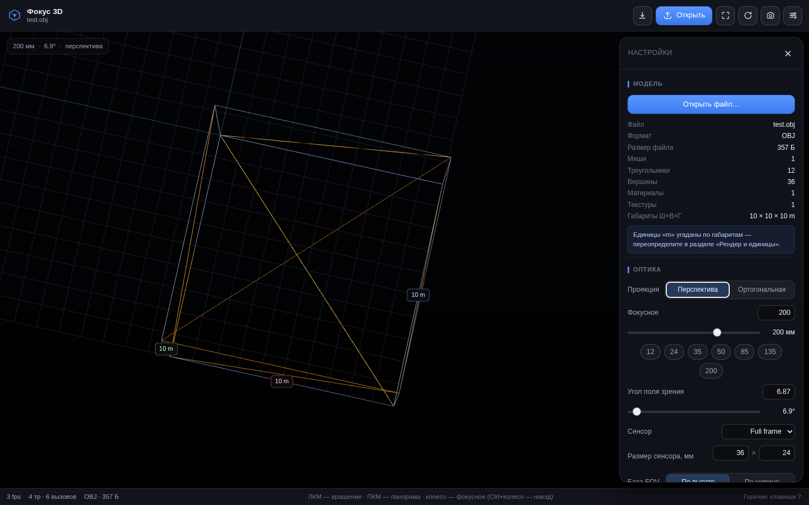

# Фокус 3D — PWA-просмотрщик 3D-моделей

Веб-приложение (PWA): загружаете 3D-модель, крутите её в пространстве, приближаете,
и **задаёте оптику камеры** — фокусное расстояние в миллиметрах, угол поля зрения,
тип матрицы (сенсор) и проекцию. Работает офлайн, ставится на домашний экран,
модели никуда не отправляет — вся геометрия считается в браузере.



## Что умеет

**Загрузка**
- Drag-n-drop в окно или кнопка «Открыть файл»
- Форматы: **glTF, GLB, OBJ (+MTL), STL, PLY, FBX**
- Сжатие: **Draco** и **KTX2/Basis** (декодеры лежат локально, работают офлайн)
- Текстуры и `.bin` подхватываются из того же drag-n-drop — можно кидать пачкой файлов
- Статистика: меши, треугольники, вершины, материалы, текстуры, размер файла
- Единицы измерения угадываются по габаритам, но переопределяются вручную

**Камера и оптика**
- Фокусное расстояние **4–1200 мм** и угол поля зрения связаны по формуле
  `f = d / (2·tan(FOV/2))` и редактируются в обе стороны
- Сенсоры: Full frame, APS-C, M 4/3, 1", Super 35 + произвольный размер
- База FOV: по высоте сенсора (фото-стандарт) или по ширине
- Проекция: перспективная ↔ ортогональная с сохранением кадрирования
- Линзовый сдвиг кадра — модель центрируется в видимой области, а не под панелью
- Режим колеса: менять **фокусное** (зум-объективом) или **дистанцию** (наезд)

**Сцена**
- Сетка, оси, пол с мягкой тенью, рамка габаритов с подписями Ш×В×Г
- Каркас, «глина» (нейтральный материал), рёбра (пересечения рёбер)
- Ракурсы: изометрия, фронт, зад, слева, справа, сверху
- Фон: градиент / тёмный / светлый / прозрачный
- Тонмаппинг ACES · AgX · Neutral · Reinhard, экспозиция, интенсивность окружения
- Экспорт кадра в PNG (в том числе с прозрачным фоном)
- Демо-фигуры, чтобы приложение было чем наполнить до загрузки своего файла

**PWA**
- Ставится на домашний экран (манифест, иконки 192/512 + maskable, apple-touch-icon)
- Полностью офлайн после первой загрузки: app shell и декодеры в precache
- Автообновление с тостом «досталось обновление»
- Горячие клавиши на десктопе, управление одним пальцем на тач-устройствах

## Запуск

```bash
npm install
npm run dev        # http://localhost:5173
npm run build      # сборка в dist/ + precache service worker
npm run preview    # локальный просмотр собранной версии
npm test           # сборка + e2e-смоук в headless Chromium
npm run icons      # перегенерировать иконки (нужен Pillow)
```

> PWA (service worker, установка) работает только по HTTPS или на `localhost`.
> Собранную папку `dist/` можно положить на любой статический хостинг —
> путь базы относительный, так что и корень сайта, и подпапка подойдут.

## Проверка

```bash
node scripts/smoke.mjs    # e2e-прогон в headless Chromium: 22 проверки
node scripts/shots.mjs    # контрольные скриншоты в ./screenshots
```

Смоук поднимает `vite preview`, открывает приложение с программным WebGL,
грузит демо-фигуру, настоящий STL и OBJ+MTL+текстуру, проверяет пересчёт
оптики, ортокамеру, экспорт PNG, манифест, иконки и регистрацию service worker.

Для тестов нужен Chromium: `npx playwright install chromium`
(либо переменная окружения `CHROME_PATH`).

## Иконки

```bash
python3 scripts/gen-icons.py
```

Рисует `public/icons/*.png` и `public/apple-touch-icon-180.png` (Pillow),
плюс `public/favicon.svg` генерируется здесь же.

## Структура

```
index.html              разметка оболочки
src/
  main.js               сборка: загрузка файлов, клавиатура, статус-бар, PWA
  viewer.js             three.js: сцена, камеры, оптика, свет,helpers
  optics.js             математика «фокусное ↔ FOV», сенсоры
  loaders.js            glTF/OBJ/STL/PLY/FBX + Draco/KTX2, статистика модели
  demo.js               процедурные демо-фигуры
  ui.js                 панель настроек (собирается кодом)
  pwa.js                регистрация service worker, обновления, установка
scripts/
  gen-icons.py          генерация иконок
  smoke.mjs             e2e-тесты
  shots.mjs             скриншоты
```

## Заметки по реализации

- **FOV считается по вертикали** — так же, как в three.js. Для full frame
  это 24 мм, поэтому привычные 50 мм дают 27°, а не 39.6° (39.6° — это по горизонтали).
  База переключается в панели.
- **Смена сенсора держит фокусное** (смена носителя при том же объективе → меняется
  FOV), **смена базы держит FOV** (картинка не прыгает, меняется только подпись).
- **Линзовый сдвиг** сделан через `PerspectiveCamera.filmOffset`: перспективные
  искажения объекта не меняются, в отличие от сдвига самой камеры.
- **Габариты** считаются в системе координат модели и масштабируются на коэффициент
  единиц только для подписей — сама геометрия не трогается.
- Тяжёёлые модели (>1.2 млн треугольников) автоматически остаются без слоя рёбер.
